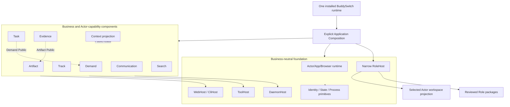

# BuddySwitch Explicit Modular Monolith Design

> Status: accepted target architecture; runtime not yet migrated
> Date: 2026-07-28
> Evidence baseline: `9e527141ef9c6ca705015fcecfa0b2a6fe1c3fc3`
> Readiness audit: `2026-07-28-buddyswitch-modular-monolith-readiness-audit.md`
> Current executable truth remains: `docs/arch/**`

## 1. Decision

BuddySwitch will be rebuilt forward as:

> one packaged modular monolith with explicit component composition,
> business-neutral foundation hosts, one attributable runtime distribution,
> code-free Actor workspaces, and a narrow RoleHost.

The target laws are:

1. `src/buddyswitch/**` is the only Python implementation/runtime source root.
2. Product and Actor-capability behavior is physically aggregated by component.
3. The application explicitly imports one assembly per component.
4. Generic hosts receive typed contributions and know no product semantics.
5. All BuddySwitch processes execute one installed runtime identity.
6. Actor workspaces contain selected Role/Skill/config/private/project
   projections, never BuddySwitch implementation or all Roles.
7. Role is the only earned directory-discovered extension type.
8. Every migrated owner has one live path; old code, assets, tests, guidance,
   aliases, scanners and fallbacks are removed in the same cutover.

## 2. Bottleneck

The current system already has meaningful semantic owners, but a product
change is distributed across:

```text
scripts/env/domain
scripts/env/repos
scripts/env/tools
scripts/env/tool_runtime
tools/launcher
buddyswitch/skills
buddyswitch/manifest.toml
framework/contracts
tests
```

It also has split runtime provenance:

```text
checkout CLI/Host/Web/Daemon/MCP
  + Actor-workspace Broker/tool copies
  + Broker dynamic checkout handler loading
```

This prevents private product work from being local and makes a source-root
move unsafe unless packaging, lifecycle and Actor projection are solved first.

## 3. Architecture



## 4. Complete repository topology

```text
pyproject.toml
buddyswitch-codex
buddyswitch-test
AGENTS.md
README.md
.gitignore

src/buddyswitch/
  application/
    composition.py
    build.py
    entrypoints/

  foundation/
    composition/
    identity/
    state/
    actor_runtime/
    process_runtime/
    app_server/
    daemon/
    tool_runtime/
    browser_runtime/
    web_runtime/
    cli_runtime/
    role_host/

  modules/
    demand/
    task/
    track/
    artifact/
    communication/
    search/
    evidence/
    context/

  roles/
    market/
    pm/
    design/
    dev/
    test/
    secondary_market_investor/

  assets/

tests/
  unit/architecture/
  integration/
  process/
  system/
  support/
  runner.py

projects/app/
docs/arch/
docs/memo/

.buddyswitch-runtime/              generated, gitignored, never source
  activation.json                 one active installed-runtime identity
  venv/                           non-editable package installation
```

Only directories earned by current code are created. The tree is not an
instruction to add empty abstractions.

## 5. Component anatomy

```text
modules/<name>/
  module.py
  public/
  private/
  assets/
  skills/
  tests/
    unit/
    contract/
    integration/
```

### 5.1 Public

Public contains only contracts with a real cross-owner consumer:

- exact commands/application operations;
- exact read projections;
- value types and errors;
- bounded cleanup contract when needed.

It does not contain repositories, host DTOs, private re-exports, compatibility
facades or speculative service interfaces.

### 5.2 Private

Private is the frequent change surface:

- domain and orchestration;
- schema and repositories;
- Tool/Daemon/Web/CLI adapters;
- prompt/Skill implementation;
- assets and local helpers.

A normal private change stays inside the component root.

### 5.3 `module.py`

`module.py` constructs one passive typed assembly from private adapters:

```text
ModuleAssembly
  name
  daemon registrations
  Tool registrations
  Web/CLI registrations
  Skill exports
  optional cleanup contribution
```

The exact type contains only fields required by current components. It has no
discovery, lifecycle, dependency negotiation, service locator or side effects.

The application root imports only `modules.<name>.module`.

## 6. Component ownership

| Component | Owns |
|---|---|
| Demand | canonical need aggregate, triage/orchestration semantics and state |
| Task | canonical Task, Demand binding and native Goal convergence semantics |
| Track | Track/comment state and collaboration projections |
| Artifact | artifact state, relations, visibility and selection config |
| Communication | Message/IM state, delivery, external sessions and channel adapters |
| Search | bounded Actor search affordance/backends; no product state |
| Evidence | transient evidence/downgrade capability through Artifact Public |
| Context | application read projection across component Public queries and Tool catalog |

Browser is an Actor runtime capability, not a product component. Identity,
source-reference values, Actor-private files, state locators and cleanup
orchestration belong to foundation primitives/hosts as described below.

## 7. Foundation boundaries

Foundation owns product-neutral contracts and execution only:

| Owner | Responsibility |
|---|---|
| Application composition | explicit component set, duplicate validation, host construction |
| Identity | shared identity values and invariants |
| State | explicit locators, path safety, atomic files and locks |
| Actor runtime | build/start/status/input/interrupt/compact/clear/resume/stop/delete |
| Process runtime | process identity, sockets, PIDs, logs, temp and cleanup facts |
| App Server | Codex RPC/process supervision |
| DaemonHost | trigger, mailbox, schedule, dispatch, host telemetry |
| ToolHost | schema, authority, catalog and invoke |
| Browser runtime | Actor-scoped CDP/proxy lifecycle |
| WebHost/CliHost | transport, parsing, route/command invocation and error mapping |
| RoleHost | reviewed Role discovery, validation and selected projection |

Dependencies point inward:

```text
application -> concrete components and hosts
component private adapters -> receiving-host contracts
component A -> component B Public only
foundation -X-> concrete component or Role
```

## 8. Daemon and Tool composition

Daemon remains business-neutral. A component handler owns whether an event
causes a message, prompt, reconciliation or other business action. Daemon
invokes it and records host facts.

Tool Runtime no longer scans `env.tools`. The application combines exact
`ToolRegistration` values. Invalid or duplicate Tools fail application build;
they are not silently omitted.

`ToolContext` becomes host facts plus explicitly injected public capabilities.
It does not hard-code every product repository/domain.

## 9. Web, CLI and cleanup

Web and CLI are peer adapters calling owners directly:

```text
component private projection -> WebHost/CliHost registration
Actor runtime operations -> lifecycle routes/commands
Communication -> IM routes and independently owned iMessage worker
```

Generic hosts do not import Task, Track, IM or other products.

Cleanup is split:

```text
foundation lifecycle/path-safety orchestration
  + component-owned state attribution/deletion contributions
```

A generic cleanup host never copies product schema/ownership rules.

## 10. Role and Skill model

Role packages are reviewed repository code:

```text
roles/<id>/
  role.py
  AGENTS.md
  private/
  skills/
  assets/
  tests/
```

Skills have two owners:

- component-exported `SkillExport` artifacts;
- Role-private `SkillExport` artifacts.

The application assembles component Skill exports. A Role descriptor selects
Skill IDs. RoleHost validates the selection and materializes only the selected
Role and Skills.

Adding a valid Role directory does not edit application composition, Daemon,
ToolHost, WebHost or a central Role manifest. Invalid/duplicate Roles fail
before Actor publication.

RoleHost is not a general plugin host.

## 11. Package and runtime model

`pyproject.toml` is the only package/build owner. S1 uses the standard
`setuptools.build_meta` backend and a non-editable wheel installation. The
built distribution:

- includes executable package code and required Role/Skill/config/static
  assets;
- excludes all tests, docs, product source and repository wrappers.

The source checkout has one active local runtime:

```text
<checkout>/.buddyswitch-runtime/venv/bin/python
<checkout>/.buddyswitch-runtime/activation.json
```

Installation is explicit, never editable, and never performed implicitly by
Actor start. The installed package writes `activation.json` only after
installation verification. The record binds:

- normalized source root and source digest;
- package version and installed distribution digest;
- exact Python executable and package root;
- activation time and schema version.

The activation source digest covers the sorted path/content manifest of
`pyproject.toml` and `src/buddyswitch/**` build inputs. Tests, docs, wrappers
and generated runtime state are excluded. Installed-content verification uses
the installed distribution manifest and hashes, not a source import or
editable-install pointer.

Initial provisioning is an explicit setup operation performed with an
operator-selected Python satisfying `requires-python`: build one wheel through
PEP 517, create the target venv, install the wheel non-editably, then run the
installed runtime activation entrypoint. Product launchers and Actor lifecycle
operations never install, repair or upgrade the runtime.

The root launchers resolve the checkout-local active runtime above, or one
explicit `BUDDYSWITCH_RUNTIME_DIR` with the same `venv/` plus
`activation.json` shape. The thin shell resolves only the runtime directory
and deterministic `venv/bin/python`; it does not parse JSON. The installed
package verifies that the activation record names the same interpreter and
matches source/distribution/package-root identity. The launchers derive and
export `BUDDYSWITCH_PYTHON`; an independent interpreter override is not
allowed. They fail closed when the package is missing, editable, outside the
recorded package root, or does not match the activation record. They do not
fall back to `PATH` Python or rebuild at launch.

All BuddySwitch processes inherit and execute this exact interpreter and
package. Runtime status identifies the same package version, source identity,
digest, Python and package root. This is one active development/deployment
runtime, not a multi-version manager.

No BuddySwitch production process:

- executes a checkout `.py` file;
- mutates `sys.path`;
- relies on repository `PYTHONPATH`;
- dynamically loads a source file;
- infers state from package parent depth.

Actor build therefore projects product inputs only. It neither installs nor
copies the BuddySwitch runtime.

## 12. Actor workspace and product mount

Final Actor workspace:

```text
instances/<actor-id>/
  instance.json
  workspace/
    AGENTS.md
    .agents/skills/<selected>/
    private/
    projects/app -> shared project
  home/
  codex-home/config.toml
  xdg-config/
  tmp/
  runtime/
  browser/
```

It contains no BuddySwitch source, tests, docs, all-Role catalog or unselected
Skills.

`projects/app` remains outside the package. It is seeded once into the shared
project workspace and projected to Actors; it is the product source Actors
work on, not BuddySwitch runtime.

## 13. State

Foundation supplies explicit shared/instance locator values. Product
repositories receive locators and own their canonical subpaths/schemas.

This refactor does not implicitly relocate user data. If a canonical data path
must change, it enters Protected mode as an explicit bounded data migration
with one write path and a removal trigger.

## 14. Tests

One public command remains:

```bash
./buddyswitch-test focused <file-or-nodeid>...
./buddyswitch-test full
```

The root test wrapper uses the same activated interpreter and may execute the
root-owned `tests/runner.py`; that runner clears source `PYTHONPATH` and proves
the `buddyswitch` package under test resolves from the activated installation.
This test-only path is not a production implementation root. Every product
launcher and BuddySwitch child remains package-entrypoint-only.

Approved local tests:

```text
modules/*/tests/{unit,contract,integration}
roles/*/tests/{unit,contract,integration}
```

Cross-component/application/process/system/architecture tests remain root
owned. The runner discovers each once, retains system resource locking, and
the built runtime excludes every test.

Architecture tests prove:

- foundation imports no component/Role;
- components import no other component's private code;
- public graph is acyclic;
- application imports only module assemblies;
- no product module discovery;
- no duplicate registration;
- package contents and Actor projection allowlists;
- old paths and runtime source-loading are absent.

## 15. Explicit non-goals

The target does not include:

- universal plugins;
- arbitrary component discovery;
- dependency injection;
- semantic event bus;
- service split;
- `requires/provides` negotiation;
- runtime component lifecycle callbacks;
- compatibility aliases/fallbacks;
- a second test or Skill loader.

## 16. Replacement

Final disposition:

```text
scripts/** executable/product code       -> package owner, old path deleted
tools/launcher/** executable code/assets  -> package owner, old path deleted
buddyswitch manifest/profiles/skills      -> Role/module owner, old path deleted
framework runtime contracts/config        -> owning package, old path deleted
```

Root shell entrypoints, root tests/docs and `projects/app` remain because they
are distinct current interfaces/data, not alternative implementation paths.

## 17. Migration authority

The accepted stage order is owned by:

`2026-07-28-buddyswitch-modular-monolith-migration-roadmap.md`.

Runtime work cannot begin until the readiness audit issues its final decision
and S1 has an exact reviewed implementation plan.
