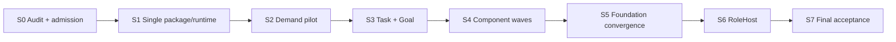

# BuddySwitch Modular Monolith Migration Roadmap

> Status: completed; historical migration roadmap
> Runtime authorization: none; every stage and Goal Packet is consumed
> Target: `2026-07-28-buddyswitch-explicit-modular-monolith-design.md`
> Audit: `2026-07-28-buddyswitch-modular-monolith-readiness-audit.md`
> Execution pack: `2026-07-28-buddyswitch-modular-monolith-migration/README.md`
> Program acceptance: `2026-07-28-buddyswitch-modular-monolith-migration/07-final-acceptance-plan/S7-ACCEPTANCE.md`

All stage-state and authorization statements below preserve their planning-time
context only. They do not grant current execution authority.

## 1. Outcome

The program is complete only when:

> BuddySwitch executes from one installed package built from
> `src/buddyswitch/**`; Actor workspaces contain no implementation; product and
> Actor-capability components are physically aggregated and explicitly
> composed; foundation hosts are business-neutral; RoleHost is the only narrow
> discovery extension; and every old executable path, duplicate catalog,
> fallback, scanner, test assertion and current guidance surface is absent.

## 2. Why the previous roadmap was replaced

The prior Demand-first sequence omitted:

- package/install/bootstrap;
- Actor runtime distribution;
- split checkout/workspace provenance;
- complete lifecycle transitions;
- Identity/Search/Evidence/Context ownership;
- Web/IM/Browser/cleanup seams;
- Role-to-module Skill exports;
- test/package/guidance replacement scope.

Demand cannot safely move while its Tool/Daemon/Role/runtime paths execute from
two sources. The runtime/package cutover must precede component migration.

## 3. Program graph



## 4. Stage summary

| Stage | Accepted outcome | Runtime merge | Charter |
|---|---|---:|---|
| S0 | audit, target, ledgers, residue/proof topology and S1 blueprint are complete | no | `00-program-readiness.md` |
| S1 | all BuddySwitch processes use one installed package; Actor workspace has no implementation; old executable roots absent | yes | `01-single-package-runtime-cutover.md` |
| S2 | Demand is one physical component and first typed component assembly | yes | `02-demand-component-pilot.md` |
| S3 | Task/Goal is one component with exact Demand Public edge | yes | `03-task-goal-boundary-cutover.md` |
| S4 | Track, Artifact, Communication, Search, Evidence and Context move in owner lanes | yes, one lane at a time | `04-independent-component-waves.md` |
| S5 | foundation hosts contain no product semantics; scanners/dynamic loads/broad contexts gone | yes | `05-foundation-convergence.md` |
| S6 | narrow RoleHost replaces central Role/Skill/profile/contract truth | yes | `06-role-host-cutover.md` |
| S7 | full product/contract/architecture/replacement/operations evidence agrees | yes | `07-final-acceptance.md` |

Paths are relative to the execution-pack directory.

## 5. Stage state machine

```text
PROPOSED -> READY -> IN_PROGRESS -> ACCEPTANCE_PENDING -> ACCEPTED
```

Exceptional:

```text
PAUSED
REPLANNING
REOPENED
REJECTED
```

No checklist completion substitutes for acceptance evidence.

## 6. Forward migration laws

1. one mergeable stage leaves one runnable current truth;
2. one migrated owner has one import/registration/read/write/projection path;
3. no alias, shim, fallback, symlink, duplicate registration, dual read/write
   or source-loader is introduced;
4. unmigrated behavior remains current until its direct cutover;
5. S1 internal checkpoints do not merge independently;
6. every source/asset/test/guidance consumer changes with its owner;
7. application composition may explicitly name unmigrated private pieces
   during S2–S4, but a migrated component appears only as its assembly;
8. generic hosts never discover product components;
9. RoleHost discovers only reviewed packaged Role directories;
10. every runtime stage re-proves complete Actor lifecycle and cleanup;
11. canonical data does not move implicitly with source;
12. no executor invents unresolved architecture.

## 7. S0 — Audit and admission

Acceptance:

> The program can be handed off without requiring the S1 executor to infer
> repository topology, runtime distribution, lifecycle, target boundaries,
> proof or residue.

S0 owns documents only. It closes when:

- current A01–A12 trace is complete;
- target repository/runtime/Actor/state trees are exact;
- component/foundation/Role boundaries are accepted;
- finding and residue registers cover known scope;
- canonical roadmap/charters agree;
- the S1 architecture/checkpoint blueprint is reviewed;
- runtime code remains unchanged.

## 8. S1 — Single package/runtime cutover

Acceptance:

> Every current BuddySwitch behavior executes from one installed package built
> from `src/buddyswitch/**`; all processes share one runtime identity; Actor
> workspaces contain selected projections only; old executable roots and
> path-surgery bootstraps are absent.

S1 is deliberately broad because package/provenance touches every lifecycle
operation. It is developed through review checkpoints on one branch and merged
only as a complete vertical replacement.

S1 preserves current product semantics and fine-grained composition. It does
not yet claim component modularity.

## 9. S2 — Demand component pilot

Acceptance:

> Demand private behavior, state, adapters, assets, exported Skills and local
> tests live under one root; the application selects Demand once; hosts contain
> no Demand-specific composition.

S2 creates only host contribution contracts demanded by current Demand paths.
It also enables approved co-located test roots in the one runner.

## 10. S3 — Task and Goal boundary

Acceptance:

> Task owns Task and native Goal convergence semantics in one component;
> Demand collaboration uses exact Public operations; no private cross-read or
> duplicate write path exists.

This proves that the component model works across a real dependency, not only
within one isolated owner.

## 11. S4 — Independent component waves

One plan/candidate per:

1. Track/comments;
2. Artifact/relations/visibility/config;
3. Communication/IM/channel worker;
4. Search;
5. Evidence;
6. Context projection.

Context moves last because it consumes public projections from the others.
Browser is an Actor foundation capability and is not a product lane.

Parallel lanes require frozen host contracts, disjoint ownership and one
application-root integration owner.

## 12. S5 — Foundation convergence

Acceptance:

> Foundation contains only product-neutral execution and primitives; all
> product meaning arrives through typed component contributions.

S5 removes remaining:

- Tool directory scanning;
- dynamic checkout/source loading;
- broad product-aware ToolContext;
- product imports in Web/CLI/Daemon entrypoints;
- mixed product rules in cleanup;
- fragmented Browser/process/runtime ownership.

S5 is not permission to defer a component's own semantic cutover.

## 13. S6 — RoleHost cutover

Acceptance:

> A reviewed Role package is addable by directory alone; only selected
> Role/Skill content reaches an Actor; central Role/Skill/profile/contract truth
> is absent.

S6 follows component migration because Roles select module-exported Skills.
It proves the extension boundary with a secondary-market-investor Role package
without requiring product-host edits.

## 14. S7 — Final acceptance

Acceptance:

> Product, Contract, Architecture, Replacement and Operations evidence agree
> that the target is the only live architecture.

S7 executes the frozen full candidate, representative real Actor journeys,
distribution/Actor allowlist checks, residue scans, data/cleanup checks and
current-doc promotion. Material defects reopen the owning stage.

## 15. Stage entry gate

A stage becomes READY only when:

- predecessor accepted;
- source identity and dirty scope recorded;
- current owner/consumer/lifecycle path traced;
- exact move/change/delete scope named;
- protected external/data contracts named;
- direct RED or preservation proof selected;
- residue rows assigned;
- current guidance updates assigned;
- write conflicts and integration owner named;
- stop conditions recorded;
- stage implementation plan reviewed.

## 16. Stage exit gate

A stage becomes ACCEPTED only when:

- promised consumer outcome is observed;
- contracts and state effects are exact;
- dependency/ownership architecture is machine-proved;
- every migrated old path/registration/asset/test/guidance surface is absent;
- start/status/input/interrupt/compact/clear/resume/stop/delete remain truthful;
- affected Web/IM/Browser/Daemon/Broker/App paths pass;
- runtime identity and distribution contents agree;
- process/socket/lock/temp cleanup is clean;
- no later stage is needed to make the stage's claim true.

## 17. Parallelism policy

| Surface | Policy |
|---|---|
| S1 package/runtime/lifecycle | one integration branch; internal work may be reviewed in disjoint checkpoints but not independently merged |
| separate S4 component roots | parallel after contracts freeze |
| application composition | one integration owner |
| foundation host contracts | frozen during lanes unless decision log reopens them |
| RoleHost | waits for final component Skill exports |
| root architecture/process/system tests | one named owner per active candidate |
| `docs/arch/**` | changed with executable owner, never speculatively |

Final architecture aims for high private-change parallelism. Migration work is
not allowed to fake that parallelism before boundaries exist.

## 18. Executor handoff

The executor receives:

1. root `AGENTS.md`;
2. target design;
3. roadmap and execution governance;
4. current stage charter;
5. exact stage implementation plan;
6. applicable ledger/finding/residue rows.

Handoff card:

```text
Stage:
Acceptance sentence:
Source identity/diff:
Allowed owner/write/delete scope:
Protected contracts/data:
Direct RED/preservation proof:
Ordered runnable checkpoints:
Forbidden expansions:
Required evidence:
Stop conditions:
```

Missing fields mean the stage is not READY.

## 19. Current state

```text
S0: ACCEPTED
S1: PROPOSED
S2–S7: BLOCKED
runtime changes: not authorized
```
