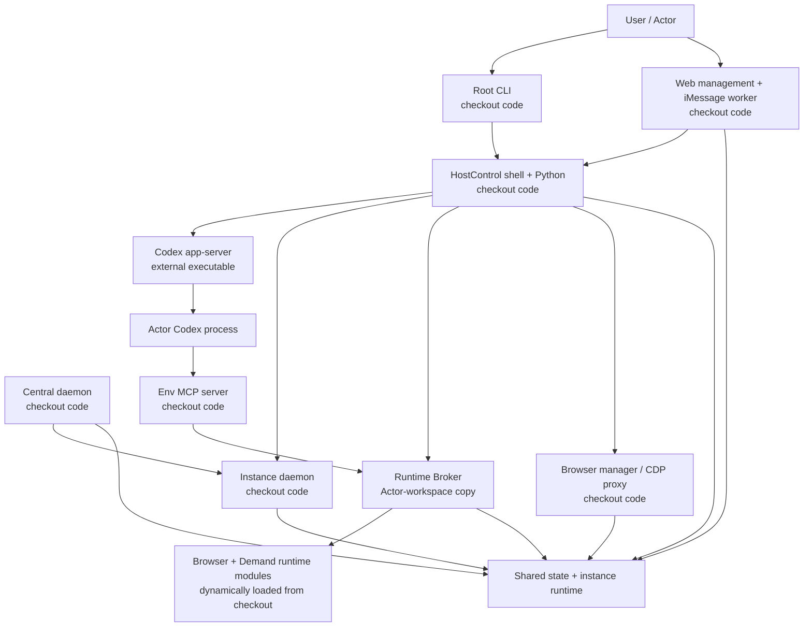

# Current BuddySwitch System Topology

> Audit status: repository fact baseline
> Evidence baseline: `9e527141ef9c6ca705015fcecfa0b2a6fe1c3fc3`
> Target authority: none; this report describes the current system only

## 1. Acceptance

This report is complete when a future topology can be checked against every
current implementation root, public entrypoint, process, runtime projection,
state root, and product/capability owner without assuming that “source root”
means only Python files in the checkout.

The earlier target did not meet this bar. In particular, it treated
`src/buddyswitch/**` as if choosing a directory also chose packaging,
deployment, Actor projection, state, configuration, tests, and deletion.

## 2. Current repository roots

BuddySwitch currently has no Python package/build declaration. There is no
`pyproject.toml`, `setup.py`, or `setup.cfg`. Runtime importability is created
by executing files by path, mutating `sys.path`, and setting `PYTHONPATH`.

| Physical root | Current responsibility | Runtime-distributed to Actor | Product/host mix |
|---|---|---:|---|
| `scripts/env/domain/**` | product domain rules and shared domain types | yes | product and cross-cutting |
| `scripts/env/repos/**` | product repositories and runtime path helpers | yes | product and state infrastructure |
| `scripts/env/services/**` | product services | yes | product |
| `scripts/env/tools/**` | Tool definitions and private implementations | yes | product/capability adapters |
| `scripts/env/tool_runtime/**` | Tool contracts, registry, authorization, context and clients | yes | host plus broad product access |
| `scripts/runtime_kernel/**` | Runtime Broker protocol, lifecycle and dispatcher | yes | host plus product loading seams |
| top-level `scripts/*.py` | manifest, profiles, diagnostics, cleanup and compatibility facades | selected files | mixed |
| `tools/launcher/**` | public orchestration, lifecycle, processes, Web, Daemon, Browser and product handlers | no | heavily mixed |
| `tools/launcher/assets/roles/**` | Role bootstrap `AGENTS.md` | selected Role only | Role |
| `tools/launcher/assets/web-management/**` | Web interface assets | no | interface |
| `buddyswitch/manifest.toml` | Role and Skill catalog | yes | Role/configuration |
| `buddyswitch/env-profiles/**` | Role environment profiles | yes | Role/runtime configuration |
| `buddyswitch/skills/**` | Role and product-operation Skills | selected Skills only | Role plus product behavior |
| `framework/contracts/**` | Role runtime contracts and context schema | yes | Role/runtime contract |
| `framework/config/**` | artifact-selection configuration | no | product configuration |
| `tests/**` | all current test tiers and test infrastructure | no | shared proof |
| `projects/app/**` | product-under-development source mounted for Actors | seeded into shared runtime state | external product data |

This physical split is the refactor pressure. It is also the complete
replacement surface. Moving only Python implementation files would leave the
old architecture live through launchers, Role assets, Skills, contracts,
tests, and runtime copies.

## 3. Public entrypoints and import bootstrap

### 3.1 Product CLI

```text
./buddyswitch-codex
  -> source tools/launcher/env.sh
  -> resolve repository-relative environment
  -> execute tools/launcher/cli.py by absolute file path
  -> HostControl / browser / Web / Demand command paths
```

Evidence:

- `buddyswitch-codex:4-6,14-30`;
- `tools/launcher/env.sh:4-8,34-57`;
- `tools/launcher/cli.py:83-115,154-218`.

The root shell file may remain a stable public interface in a future topology,
but its implementation dependency on `tools/launcher/**` is not a protected
internal contract.

### 3.2 Test CLI

```text
./buddyswitch-test
  -> source tools/launcher/env.sh
  -> export PYTHONPATH=<repo>:<repo>/scripts:<repo>/tools/launcher
  -> execute tests/runner.py
  -> pytest --import-mode=importlib / node --test / shell syntax / diff check
```

Evidence:

- `buddyswitch-test:4-9`;
- `pytest.ini:1-2`;
- `tests/runner.py:65-120,169-203,240-287`.

The runner currently rejects focused targets outside root `tests/**` and full
mode enumerates only `tests/{unit,integration,process,system}`. Therefore
co-locating module tests changes executable test policy, not only file layout.

### 3.3 Internal process bootstrap

Current processes commonly:

- derive a checkout root from `Path(__file__).parents[...]`;
- inject `scripts` or `tools/launcher` into `sys.path`;
- launch another Python file by repository path;
- pass `--repo-root` so a child can dynamically load more checkout code.

This is why a `src/` directory cannot be introduced as a runnable target
without an explicit package/build/runtime identity decision.

## 4. Current process topology



### 4.1 Process inventory

| Process/call surface | Code provenance | Main ownership today |
|---|---|---|
| root CLI | checkout | command transport and dispatch |
| HostControl | checkout | complete Actor lifecycle orchestration |
| App Server client/supervisor | checkout; launches external Codex binary | Codex RPC and process lifecycle |
| central daemon | checkout | cross-instance routing/registry |
| instance daemon | checkout | generic daemon loop plus concrete product composition |
| Web management | checkout | HTTP/UI interface plus product projections and lifecycle operations |
| iMessage worker | checkout; lifetime nested under Web | external IM channel |
| Browser manager/proxy | checkout | browser/CDP instance capability lifecycle |
| Env MCP | checkout | native MCP projection and broker client |
| Runtime Broker | copied Actor workspace | Tool dispatch and selected runtime operations |
| Runtime Broker dynamic handlers | checkout loaded by workspace process | Browser and Demand application access |
| Actor Codex | external runtime with generated config | interactive Actor |

There is no single current BuddySwitch runtime provenance. One Actor Tool call
can execute both workspace-copied code and mutable checkout code.

## 5. Current state and filesystem topology

```text
<source checkout>/
  projects/app/                         source used to seed shared project
  scripts/ tools/ buddyswitch/ ...      implementation and source assets

${BUDDYSWITCH_SHARED_ROOT}/
  project/workspace/                    seed-once shared product workspace
  state/
    buddyswitch/objects/...             Track/Artifact and other projections
    buddyswitch/local/...               local/private shared state
    im/...                              current IM state
    runtime/...                         central runtime registry/state
  instances/<actor-id>/
    instance.json                       canonical instance lifecycle record
    workspace/
      AGENTS.md                         selected Role bootstrap
      .agents/skills/<selected>/...     selected Role/product Skills
      private/...                       Actor-private files
      scripts/...                       copied runtime
      buddyswitch/manifest.toml          copied central catalog
      buddyswitch/env-profiles/...       copied profiles
      framework/contracts/...           copied Role contracts
      projects/app -> shared project     product workspace projection
    home/
    codex-home/
    xdg-config/
    tmp/
    runtime/                            broker/daemon sockets, pids, logs
    browser/                            profile and browser ownership state
```

Important distinctions:

1. `projects/app` is not BuddySwitch framework source. It is the external
   product source mounted into Actor workspaces.
2. shared canonical/product state and per-instance runtime state have different
   owners and lifecycles.
3. `scripts/env/repos/runtime_files.py:20-57` currently falls back from an
   explicit `BUDDYSWITCH_STATE_ROOT` to a root inferred from source-file parent
   depth.
4. Actor-private state is located from Actor workspace context, while cleanup
   also traverses instances and product records to attribute Role-owned data.

The target must use explicit locator contracts. Package installation depth
cannot determine product state location.

## 6. Current Actor runtime projection

`ActorEnvironmentBuilder` is the sole atomic workspace materializer, but its
input is the checkout layout.

It copies exactly:

```text
scripts/env
scripts/runtime_kernel
scripts/turn_runtime.py
scripts/env_store.py
scripts/env_legacy_store.py
scripts/env_manifest.py
scripts/env_profiles.py
scripts/browser_evidence.py
buddyswitch/manifest.toml
buddyswitch/env-profiles
framework/contracts
```

It additionally:

- copies the selected Role `AGENTS.md`;
- resolves the Role through the central manifest;
- copies only Skills selected by that Role into `.agents/skills`;
- seeds the shared project workspace once from `projects/app`;
- links the Actor to the shared project;
- rejects `tools`, `tests`, `docs`, `README.md`, `buddyswitch-codex`, and
  `runs` in the Actor workspace;
- validates before atomically publishing the instance directory.

Evidence:

- `tools/launcher/actor_environment.py:26-49,101-129,160-205,328-437`;
- `scripts/runtime_skills.py:84-153,174-203`;
- `tests/unit/launcher/test_actor_environment.py`;
- `tests/process/cli/test_clean_runtime_environment.py`.

This projection is an actual deployment artifact even though it is currently
assembled by copying source files. Any final topology must replace it
explicitly.

## 7. Current product and capability inventory

The following is an inventory, not the target classification.

| Capability | Current source evidence | Current consumers | Target classification unresolved |
|---|---|---|---:|
| Demand | domain, repo, Tool, daemon/triage/orchestration handlers, Skills | Tool, daemon, Role, Task/Goal, tests | no |
| Task + Goal | domain, Tool, daemon command handlers/runtime | Tool, daemon, Demand, Web, tests | no |
| Track + comments | domain, repo, Tool, inbound handlers | Tool, daemon, Web, cleanup, Skills | no |
| Artifact | domain, repo, Tool, selection/config | Tool, cleanup, Skills | no |
| Message/IM | repo, service, Tool, inbound, HTTP, worker, external session | daemon, Web, cleanup, Actor delivery | no |
| Identity | domain/repo plus Web identity | daemon, Web, IM, repositories, ToolContext | yes |
| Actor-private files | domain/repo | ToolContext, cleanup, Actor workspace | yes |
| Source refs | domain | product objects and projections | yes |
| Search | Tool/capability implementation | Actors and Role Skills | yes |
| Evidence | Tool/capability implementation, browser evidence | Actors and Role Skills | yes |
| Context | Tool and broad ToolContext | every Actor Tool path | yes |
| Browser/CDP | scripts plus launcher managers/handlers/proxy | lifecycle, daemon, broker, Actor | yes |
| Daemon | generic core plus product composition | instance lifecycle and inbound actions | foundation, but composition unresolved |
| Runtime Broker | protocol/server/dispatcher | Env MCP and Actor | foundation |
| App Server | client/supervisor | Actor lifecycle | foundation |
| Web/CLI | transports plus product projections | users/operators | interface hosts |
| cleanup | generic path safety plus product attribution/deletion rules | operator and tests | split owner unresolved |
| Role/Skill/profile | manifest, Role assets, Skills, contracts, profiles | builder, config, Actor | RoleHost plus module exports unresolved |

The earlier list of Demand, Task, Track, Artifact, Message, and Browser was
not a complete architecture inventory. In particular, Browser has more
evidence as a host capability than as a canonical product aggregate.

## 8. Current composition mechanisms

BuddySwitch currently uses three materially different forms:

1. **Explicit fine-grained imports.** `instance_daemon.py` imports and orders
   concrete product handlers.
2. **Directory scanning.** Tool Registry scans `env.tools` packages and imports
   `<tool>.tool`.
3. **Central catalog selection.** `manifest.toml` enumerates every Skill and
   Role, then Role construction copies the selected packages.

There is also dynamic file loading in Runtime Broker dispatcher:

- `tools/launcher/browser_runtime_manager.py`;
- `tools/launcher/demand_triage_runtime.py`.

The target cannot add module assembly on top of all four mechanisms and call
the result decoupled. Each capability needs one current composition truth at
each accepted migration stage.

## 9. Current cleanup and recovery ownership

`scripts/env_cleanup.py` is a 1,016-line cross-product operation. It:

- loads valid Roles from the central manifest;
- discovers Track, Artifact, Message and comment records;
- attributes records to Roles/Actors;
- detects retired Message schema;
- traverses instances and Actor-private workspaces;
- builds a plan before deletion;
- applies path-safety and ownership checks.

Actor lifecycle cleanup separately coordinates Daemon, App Server, Runtime
Broker, Browser, instance status and the instance directory.

Therefore cleanup has two target responsibilities:

```text
foundation lifecycle cleanup
  + module-owned state attribution/deletion contributions
```

Leaving all product deletion rules in a generic foundation file would preserve
the same coupling under a new directory.

## 10. Test and guidance blast radius

The target cutover affects:

- runner discovery and focused-target validation;
- architecture tests that name old roots;
- process/system fakes that assert copied runtime paths;
- Role/Skill tests that assert `scripts/turn_runtime.py`;
- Web/Browser/Daemon launch tests that assert launcher paths;
- root `README.md` and `AGENTS.md`;
- all current `docs/arch/**` whose stable paths change;
- Role `AGENTS.md`, Skills, framework contracts and help text.

These are not post-migration polish. They are current consumers or proof
owners and must change in the stage that changes their underlying truth.

## 11. Fact conclusions

The current topology disproves these earlier assumptions:

| Earlier assumption | Current fact |
|---|---|
| choosing `src/buddyswitch` chooses the final source topology | packaging, entrypoints, assets, tests, state and runtime projection remain unspecified |
| Actor workspace is only Role/config data | it contains and executes a selected BuddySwitch runtime copy |
| one runtime path exists per Actor | one request can cross workspace and checkout code |
| the proposed product-module list covers current behavior | several shared capabilities and lifecycle owners are unclassified |
| Role-private and module-private Skills can be freely co-located | Role selection is a real cross-boundary consumer requiring an export contract |
| product modules can move before host convergence with only a small assembly edit | Web, cleanup, ToolContext, broker loading and tests are shared consumer seams |

These conclusions support findings F-001 through F-021. They do not yet choose
the target solution.
