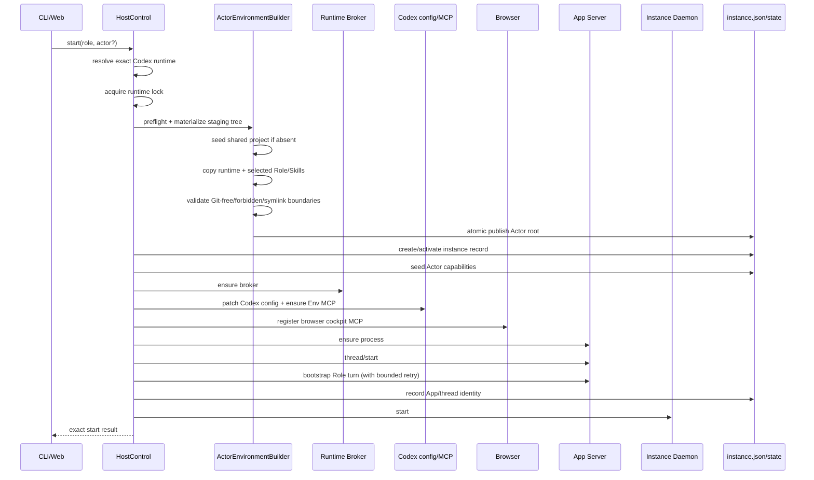
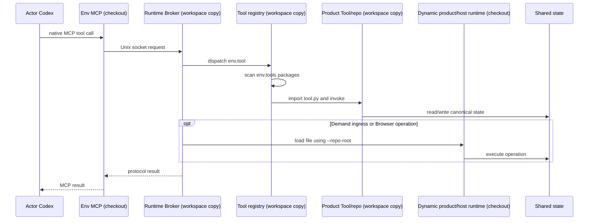

# Actor Lifecycle and Runtime Projection Audit

> Audit status: current consumer-path baseline
> Evidence baseline: `9e527141ef9c6ca705015fcecfa0b2a6fe1c3fc3`
> Target authority: none; required invariants are migration inputs

## 1. Acceptance

This report is complete when the complete Actor lifecycle and one Actor Tool
request are traced through publication, processes, source provenance, state,
failure cleanup, and deletion.

The migration may not move an owner while leaving an unassigned step in this
matrix. “The module imports successfully” is not lifecycle acceptance.

## 2. Lifecycle authority

Current authority is layered:

```text
CLI / Web
  -> HostControl Python contract/result validation
    -> host_control.sh lifecycle coordinator
      -> ActorEnvironmentBuilder
      -> Runtime Broker manager
      -> Browser manager
      -> App Server manager
      -> instance Daemon manager
      -> instance.json updates and cleanup
```

The shell implementation is large, but it is not merely glue. It owns
transaction ordering and failure effects. Any target replacement must first
preserve those semantics under one package-owned lifecycle operation.

## 3. Actor start

### 3.1 Success sequence



Evidence:

- `tools/launcher/host_control.sh:309-380,384-437,489-591`;
- `tools/launcher/actor_environment.py:101-129`;
- `tools/launcher/env.sh:99-140,199-312`;
- `tools/launcher/runtime_broker.sh:31-104`;
- `tools/launcher/host_control.py:104-179`.

### 3.2 Publication boundary

The Actor filesystem is built in staging and atomically renamed before child
process startup. After publication, later startup failures do not delete the
Actor environment. Instead they stop spawned services and record an inactive
failure with phase attribution.

This distinction must remain exact:

```text
pre-publication failure -> no Actor root published
post-publication failure -> Actor root retained, services cleaned, failure recorded
```

### 3.3 Start failure cleanup

For a post-publication failure the coordinator attempts, in order:

1. stop instance Daemon;
2. stop App Server;
3. stop Runtime Broker;
4. stop Browser instance;
5. record the failed phase/message/thread/browser context.

The error result is not valid if a process, socket, PID marker, lock or
contradictory active state remains.

## 4. Lifecycle transition matrix

| Operation | Preconditions/current authority | Success effect | Failure/cleanup invariant | Target proof class |
|---|---|---|---|---|
| `roles` | manifest readable | exact Role projection | invalid catalog fails | contract |
| `start` | valid Role/runtime; new Actor root; lock | workspace, record, broker, MCP, browser registration, App thread, daemon active | atomic pre-publish failure or attributable inactive post-publish failure | product + operations |
| `list` | instances root readable | status summaries | malformed record is represented safely | contract |
| `status` | Actor exists | combined instance/App/Daemon/Broker/thread truth | no component is silently treated healthy | contract + operations |
| `input` | active recorded thread | turn submitted | error names runtime/session boundary | product |
| `interrupt` | active App and thread | exact interrupt result | no identity ambiguity | contract |
| `compact` | active App and thread | exact compaction result | no thread substitution | contract |
| `clear` | active App/thread | daemon stopped, new thread bootstrapped, record updated, daemon restarted | bootstrap/daemon failure stops App/Broker/Browser and marks inactive | product + operations |
| `resume` | existing exact Codex runtime and recorded thread | existing or new App resumes exact thread; daemon active | any mismatch/failure stops spawned services and marks inactive | product + operations |
| `stop` | Actor exists | daemon/App/Broker/Browser stopped; record inactive | residual health is an error/risk | operations |
| `delete` | Actor inactive; safe resolved root; browser ownership known | broker stopped and exact instance root removed | active/unknown browser or unsafe path blocks deletion | operations + replacement |
| Web `retry` | old Actor identified | composite delete plus replacement start | lifecycle operation remains attributable, no two live instances | product + operations |
| capability get/set | instance record valid | exact capability projection/mutation | invalid Actor/capability rejected | contract |

The roadmap must attach each row to every stage whose source, composition,
state or asset changes. It is not sufficient to postpone the matrix to final
system acceptance.

## 5. Clear and resume are independent critical paths

### 5.1 Clear

Current clear:

```text
require active service/thread
  -> stop Daemon
  -> thread/clear
  -> validate returned new thread id
  -> bootstrap new thread
  -> record new thread
  -> restart Daemon
```

If bootstrap or Daemon restart fails, it stops App Server, Runtime Broker and
Browser, then clears the active App state.

Evidence: `tools/launcher/host_control.sh:659-731`.

### 5.2 Resume

Current resume:

```text
load and validate recorded Codex executable/version
  -> validate Actor record and exact thread id
  -> if App already live: ensure Daemon
  -> else ensure Broker
  -> ensure App Server
  -> thread/resume exact recorded thread
  -> verify returned thread id equality
  -> record App identity
  -> start Daemon
```

Every process-starting failure path stops the processes it owns and marks the
instance inactive.

Evidence: `tools/launcher/host_control.sh:760-881`;
`tools/launcher/host_control.py:195-205,307-320`.

These paths prove that Actor construction is not the only migration consumer.
A runtime package that can build a new Actor but cannot resume an Actor created
by the same accepted stage is not runnable.

## 6. Stop, status and delete

### 6.1 Stop

Stop coordinates:

- Daemon stop;
- App Server stop;
- Runtime Broker stop;
- Browser stop;
- inactive instance record.

Evidence: `tools/launcher/host_control.sh:595-610,897-924`.

### 6.2 Status

Status combines:

- `instance.json`;
- App process health;
- Daemon process health;
- Runtime Broker process/socket/log health;
- current thread read;
- Browser port and instance status.

Evidence: `tools/launcher/host_control.sh:925-992`;
`tools/launcher/host_control.py:180-188`.

No single process status is the terminal truth. Migration acceptance must
preserve agreement across the components.

### 6.3 Delete

Delete:

- resolves and validates the exact instance root under the shared instances
  root;
- blocks an active App Server;
- blocks an active Browser marker;
- blocks both positively owned and ambiguously owned live Browser endpoints;
- stops the Runtime Broker;
- removes only the validated Actor root.

Evidence: `tools/launcher/host_control.sh:1056-1132`.

This is a destructive boundary. Moving Browser or runtime location ownership
without updating delete in the same stage would make the stage unsafe.

## 7. Workspace construction flow

### 7.1 Inputs

`ActorEnvironmentSpec` receives:

- checkout `repo_root`;
- shared runtime root;
- Actor ID;
- Role ID;
- source Codex home.

It derives all source assets from checkout-relative paths.

### 7.2 Materialized Actor

The builder publishes:

```text
instances/<actor-id>/
  workspace/
    AGENTS.md
    .agents/skills/<Role-selected Skill packages>
    private/
    scripts/env/**
    scripts/runtime_kernel/**
    scripts/*.py                     selected runtime files only
    buddyswitch/manifest.toml
    buddyswitch/env-profiles/**
    framework/contracts/**
    projects/app -> shared project
  home/
  codex-home/
  xdg-config/
  tmp/
```

It does not copy:

```text
tools/
tests/
docs/
README.md
buddyswitch-codex
runs/
```

### 7.3 Required target separation

A clean target must separate three artifacts:

```text
BuddySwitch implementation source
  -> filtered, attributable runtime distribution

Role/package source
  -> selected Role projection

projects/app product source
  -> shared product workspace projection
```

Raw copying of `src/buddyswitch/**` collapses these boundaries and would expose
co-located tests and every Role package to every Actor.

## 8. One Tool call, end to end



Evidence:

- `tools/launcher/env.sh:225-296`;
- `tools/launcher/env_tool_mcp_server.py`;
- `tools/launcher/runtime_broker.sh:31-104`;
- `scripts/runtime_kernel/dispatcher.py:14-53,148-168,171-249`;
- `scripts/env/tool_runtime/registry.py:29-85`.

The current execution has at least two BuddySwitch source identities:

1. copied workspace runtime;
2. checkout runtime passed via `--repo-root`.

The Env MCP is a third process but uses checkout code as well. A source edit
can therefore change an already-created Actor's behavior without rebuilding
its workspace, while other parts remain frozen at creation time.

## 9. Daemon composition path

The generic Daemon core receives handlers, subscriptions and application
command factories. That is the correct direction.

The current entrypoint still explicitly names fine-grained product pieces:

```text
message inbound
track-comment inbound
browser inbound
Demand triage
Task Goal
Demand orchestration
```

Evidence: `tools/launcher/instance_daemon.py:18-52,66-116`.

The target application root should pass whole module contributions to the
business-neutral Daemon host. Daemon does not need to understand “message
delivery” or “Demand”; the handler result/action owns that meaning.

## 10. Web and side-process lifecycle

Web management currently:

- exposes Role/Actor/lifecycle/capability routes;
- projects Task and Track state;
- owns external IM session and Web IM identity access;
- checks Daemon reachability;
- starts asynchronous lifecycle operations;
- implements composite retry;
- starts and stops the iMessage worker with the Web server process.

Evidence:

- `tools/launcher/web_management.py:27-35,267-287,297-327`;
- `tools/launcher/web_management.py:362-397,487-612`;
- `tools/launcher/web_management.py:841-884,920-964,1190-1206`.

This creates two different target concerns:

```text
WebHost: HTTP, transport, lifecycle-operation reporting, error mapping
module/host contributions: product routes/projections and independent workers
```

Moving product modules before defining this seam would require repeated edits
to the same central Web file or temporary imports back into old roots.

## 11. Migration invariants derived from the lifecycle

Every accepted runtime stage must prove:

1. all operations in the lifecycle matrix remain runnable;
2. a newly created Actor and an already-created Actor in the same stage use
   one accepted runtime identity;
3. no operation imports a migrated owner from its retired path;
4. start failure is atomic before publication and attributable after
   publication;
5. clear/resume failures clean all owned processes and mark terminal state
   consistently;
6. stop/delete understand the current Browser, Broker, App and Daemon
   locations;
7. Role/config/runtime projections are generated from current package
   contracts, not copied from a retired checkout tree;
8. shared product state is not relocated implicitly by package path;
9. `projects/app` remains the product mount and is never confused with
   BuddySwitch runtime code;
10. process identity, sockets, locks, logs and temp roots leave no residue.

## 12. Audit conclusion

The existing S1 Demand pilot cannot be authorized yet. Demand participates in:

- workspace runtime distribution;
- Tool registry;
- Runtime Broker dynamic checkout loading;
- instance Daemon composition;
- Role Skill projection;
- clear/resume behavior through the same runtime;
- Web/Task/Goal consumer paths;
- cleanup and tests.

Until the final runtime artifact and staged assembly model are chosen, moving
Demand source files would either break an Actor lifecycle path or introduce a
second live route. This supports findings F-002, F-003, F-004, F-007, F-018,
F-019, F-020 and F-021.
