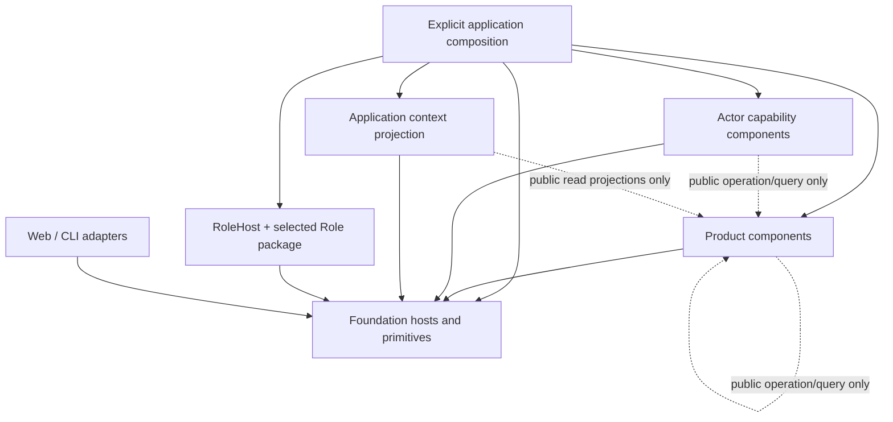

# Product, Foundation and Role Boundary Audit

> Audit status: owner inventory and target obligations
> Evidence baseline: `9e527141ef9c6ca705015fcecfa0b2a6fe1c3fc3`
> This report does not authorize runtime movement

## 1. Acceptance

This report is complete when every current behavior has:

- one semantic owner;
- one category based on responsibility, not current folder;
- exact permitted dependency directions;
- a public boundary only where a real consumer exists;
- a target contribution/consumer path;
- no requirement that generic infrastructure know product identity.

The goal is not to maximize the number of modules. The goal is to make
frequently changing private behavior local while keeping the application set
explicit and the Kernel small.

## 2. Three different concepts

The earlier design blurred three extension types.

### 2.1 Product component

A product component owns a canonical business concept, its rules and its state:

- Demand;
- Task and native Goal collaboration;
- Track and comments;
- Artifact and relations/visibility;
- Communication/IM.

It may contribute Tool actions, Daemon handlers, Web/CLI projections and
Skills. Those are adapters to its business owner, not separate owners.

### 2.2 Foundation host or primitive

A foundation host owns product-neutral execution or lifecycle:

- application composition validation;
- Tool protocol/authorization/invocation host;
- Daemon scheduling/dispatch/mailbox host;
- Actor environment and instance lifecycle;
- Codex App Server supervision;
- Browser/CDP capability lifecycle;
- Web and CLI transport;
- state locators, atomic file primitives, locks and process identity;
- Role package validation and projection.

A host may receive product contributions. It may not import product modules,
inspect product names or reproduce product rules.

### 2.3 Role package

A Role package owns an Actor specialization:

- descriptor and Role identity;
- `AGENTS.md`;
- Role-specific prompts/assets;
- Role-private Skills and execution code;
- selection of exported product/capability Skills;
- Role-specific tests.

Role is a frequent local extension and may use a narrow fail-closed RoleHost.
It is not a universal product-module plugin mechanism.

## 3. Recommended owner classification

This classification is the minimum coherent target. Exact folder names are
chosen in the target-topology report.

| Current capability | Recommended owner | Reason |
|---|---|---|
| Demand | Demand product component | canonical aggregate and write path |
| Task | Task product component | canonical execution commitment |
| native Goal bridge | Task public/application adapter to App Server | Task owns convergence meaning; App Server owns native Goal persistence |
| Track + comments | Track product component | one state and collaboration concept |
| Artifact + relations/visibility | Artifact product component | one durable artifact concept |
| Message/IM | Communication product component | message state, delivery, external projection and channel semantics |
| Identity | foundation Identity primitive | shared value/invariant used by all products and hosts; no product behavior |
| Source references | foundation value contract, with owning products validating their references | cross-product reference shape, not a write-owning product |
| Actor-private workspace/files | Actor foundation capability | instance-scoped filesystem authority and safety |
| state/runtime path location | foundation locator contracts | deployment concern, never inferred from product/package location |
| Tool contract/registry/invocation | ToolHost foundation | product-neutral protocol and duplicate validation |
| Daemon core/mailbox/schedule | DaemonHost foundation | product-neutral trigger and lifecycle |
| Runtime Broker | Actor runtime foundation | product-neutral process/protocol host |
| App Server supervision | Actor runtime foundation | external Codex process/RPC lifecycle |
| Browser/CDP/proxy | Actor host capability | instance resource lifecycle; no durable product aggregate is evident |
| Search | Actor capability component | bounded Actor affordance using Browser/search backends; no canonical product state |
| Evidence token/downgrade | Actor capability component collaborating with Artifact Public | transient capability with Artifact target validation |
| Context Tool | application-owned projection component | composes public read models and Tool catalog; must not make ToolHost product-aware |
| Web transport | WebHost foundation | HTTP/static/lifecycle-operation transport only |
| CLI transport | CliHost foundation | parsing/result transport only |
| iMessage worker | Communication-owned channel adapter with independent lifecycle contribution | product semantics and external process ownership |
| cleanup | lifecycle host plus product cleanup contributions | generic safety and product attribution must not share one owner |
| Role/Skill catalog | RoleHost plus application-exported Skill catalog | Role projection and product Skill ownership are different |

### 3.1 Why Browser is not a product component

Current Browser behavior:

- is allocated and released with an Actor instance;
- stores port/profile/process ownership in instance/runtime state;
- participates in start, stop and delete;
- exposes CDP/proxy operations;
- is used by Search and Evidence;
- has Daemon and Broker adapters.

There is no canonical “Browser business aggregate” analogous to Demand or
Task. The evidence supports an Actor host capability. If future browser
business state appears, that new evidence may earn a product component; the
current migration must not invent one.

### 3.2 Why Context is not ToolHost

Current Context reads Track, Task, Artifact, Message, Tool catalog, Role
profile and source workspace facts. Those reads are application semantics.

Making ToolHost own Context would force a generic host to import every product.
The target should instead be:

```text
application context projection
  -> product public queries + capability descriptors + ToolHost catalog
  -> contributes one context Tool to ToolHost
```

ToolHost remains unaware of what the projection contains.

## 4. Dependency direction



Required rules:

1. foundation never imports a concrete product or Role;
2. application root imports only each component's public assembly entry;
3. a product may import another product's `public` contract only;
4. a capability may use a product's `public` contract only;
5. Context uses public read models, not repositories or private rules;
6. RoleHost receives already validated Skill exports and Role descriptors;
7. Role-private code may not reach module-private implementation;
8. Web/CLI adapters call owner contracts and never storage rows;
9. cleanup host invokes module cleanup contracts and never parses product
   schemas itself.

## 5. Product component public/private boundary

### 5.1 Public is intentionally small

Public contains only current cross-owner consumers:

- an exact command/application operation;
- an exact read projection;
- boundary types and errors;
- cleanup contribution if generic cleanup must invoke product deletion;
- assembly object exported to the application root.

No public facade is created merely to hide a file move.

### 5.2 Private is the optimization target

Private contains the frequently changing surface:

- domain rules;
- canonical schema and repositories;
- internal orchestration;
- Tool/Daemon/Web/CLI adapters;
- product prompt/Skill implementation;
- product assets;
- module-owned tests.

A normal private change should touch only the component root. If it repeatedly
edits the composition root or a generic host, the boundary has failed.

### 5.3 Host contributions are public to the host, not to other products

A module's `module.py` may assemble private adapters into typed contracts owned
by receiving hosts:

```text
private Tool adapter -> ToolHost ToolRegistration
private Daemon adapter -> DaemonHost HandlerRegistration
private Web projection -> WebHost RouteRegistration
private Skill package -> RoleHost SkillExport
```

Other products do not import those private adapters. The application root
sees one immutable component assembly and passes each typed contribution to
the appropriate host.

## 6. Role and Skill boundary

### 6.1 Current coupling

The current manifest:

- centrally enumerates every Skill path;
- centrally enumerates every Role;
- lets each Role select both Role-specific and shared product Skills;
- drives Actor workspace installation.

Examples of product-operation Skills selected across Roles include:

- `track-tool`;
- `artifact-tool`;
- `demand-triage`;
- `demand-orchestration`.

Therefore a product Skill cannot be both “module-private” and directly read by
RoleHost from its private filesystem.

### 6.2 Target contract

Use two Skill sources with one materialization path:

```text
product/capability component
  -> exports SkillExport(id, package_source, contract metadata)

Role package
  -> owns Role-private SkillExport values
  -> selects exported Skill IDs in its descriptor

application composition
  -> combines component Skill exports
  -> validates duplicate IDs
  -> passes catalog to RoleHost

RoleHost
  -> validates selected Role package and Skill IDs
  -> materializes only selected packages into the Actor projection
```

`package_source` above is an implementation detail of a build/projection
contract, not a stable repository path exposed to Roles.

### 6.3 Privacy rule

“Private” means other source modules cannot import or mutate the implementation.
It does not mean the module cannot deliberately publish a typed contribution
constructed from private content.

The exported Skill package is a public runtime artifact. Any helper code not
needed by that Skill remains module-private and is excluded from the Actor
projection.

### 6.4 One Role package addition

After RoleHost cutover, adding a reviewed Role should require:

```text
roles/<id>/
  role.py or descriptor
  AGENTS.md
  private/
  skills/
  assets/
  tests/
```

and no edit to:

- application product set;
- Daemon entrypoint;
- Tool Registry;
- Web router;
- central Role/Skill manifest.

Invalid duplicate Role IDs, unknown Skill selections, unsafe paths or invalid
contracts fail before Actor publication.

## 7. Web/CLI boundary

`docs/arch/web-interface-call-architecture.md` already establishes the right
semantic rule: Web and CLI are peer adapters calling owners directly.

The physical target should make that enforceable:

```text
WebHost
  owns HTTP/static server, route matching contract, error/result mapping,
  async lifecycle-operation reporting

product component
  owns product route handler and external-safe projection

Actor host component
  owns instance lifecycle routes/operations

Communication component
  owns IM routes and iMessage worker contribution
```

WebHost receives these at application construction. It does not import Task,
Track, IM or HostControl concrete implementations.

CLI follows the same pattern. A stable root command may delegate to the
package entrypoint, but product commands are contributed by their owners.

## 8. Daemon boundary

Current `docs/arch/daemon-service-architecture.md` is directionally correct:

```text
DaemonHost: trigger, scheduling, mailbox, handler invocation, host state
Product handler: product meaning, product reread/recovery, business action
```

Target composition should therefore:

1. let each component assemble all of its Daemon registrations;
2. let the application root combine those registrations;
3. validate duplicates and malformed contracts before startup;
4. pass the full set to DaemonHost;
5. keep `instance_daemon` as a thin package entrypoint with no concrete product
   imports.

The Daemon does not “decide to代发.” A registered product handler performs the
business action; Daemon only supplies the invocation context and records host
execution facts.

## 9. Tool Runtime boundary

Current Tool Registry directory scanning is not the target application
selection mechanism. It can silently omit an invalid discovered tool from
`supported_tools()`, while final composition requires fail-closed startup.

Target:

```text
component private adapter
  -> ToolRegistration
application root
  -> explicit complete registration set
ToolHost
  -> validate duplicate/schema/authority/invoker
  -> publish catalog
  -> dispatch selected registration
```

ToolContext must shrink to host facts and explicitly injected public
capabilities. It must not be a hard-coded bag of every product repository and
domain module.

During migration, an owner is either:

- still on the accepted current Tool assembly path; or
- completely moved to explicit component assembly.

It is never registered by both.

## 10. State and cleanup boundary

### 10.1 State

Each product owns:

- its canonical schema;
- repository;
- mutation path;
- external-safe projection;
- state-relative location key.

Foundation owns:

- explicit runtime/shared/instance locator objects;
- safe path resolution;
- atomic file replacement;
- locks;
- process/runtime files.

Product repositories receive locators. They do not infer state roots from
`__file__`, current working directory or package installation depth.

### 10.2 Cleanup

Each state-owning product exports a bounded cleanup contribution:

- discover attributable records;
- validate ownership;
- produce exact deletion targets/effects;
- delete through the product repository or exact owned path contract.

Foundation cleanup owns:

- requested scope;
- path and symlink safety;
- orchestration and dry-run/result contract;
- instance-process cleanup;
- aggregation of module cleanup results.

This preserves one owner per schema and prevents a generic cleanup file from
copying product attribution rules.

## 11. Test placement

Accepted physical rule:

```text
component tests/
  unit/
  contract/
  integration/

root tests/
  architecture/
  integration/       cross-component/application
  process/
  system/
```

However, the current public runner only accepts root `tests/**`. Before any
test move:

- runner discovery must support approved co-located roots exactly once;
- focused mode must retain explicit tier classification and system locks;
- the runtime build must exclude all co-located tests;
- root architecture tests must enforce dependency and privacy boundaries;
- no second test runner or policy may appear.

## 12. Minimality guard

This classification does **not** authorize:

- a universal plugin protocol;
- arbitrary component discovery;
- dependency injection containers;
- lifecycle callbacks on product components;
- event-bus replacement of direct operations;
- `requires/provides` negotiation;
- generic service locators;
- public interfaces without real consumers;
- separate deployable services.

The intended unit is one explicit immutable assembly value per component,
passed into boring hosts by one application root.

## 13. Boundary acceptance questions

Before a component stage is READY:

1. What canonical behavior/state does it own?
2. Which current files and assets are all of its private surface?
3. Which real consumers require Public commands/queries?
4. Which typed host contributions does it currently need?
5. Which Skills are exported and which are Role-private?
6. Which state and cleanup rules move with it?
7. Which Web/CLI/Daemon/Tool consumers cut over in the same stage?
8. Which Actor runtime artifact includes its executable contribution?
9. Which tests move locally and which remain root-owned?
10. What exact old path and guidance disappear?

If an executor must answer one of these during implementation, the stage is not
prepared.

## 14. Audit conclusion

The target is still an explicit modular monolith, but “product modules under
one source root” is insufficient. The complete architecture needs:

```text
explicit application composition
  + business-semantic product/capability components
  + small product-neutral hosts/primitives
  + narrow RoleHost
  + filtered runtime/Role projections
```

This closes the conceptual gaps behind findings F-009, F-010, F-014, F-015,
F-016, F-017 and F-021. The findings remain OPEN until the target topology and
migration stages adopt and prove these boundaries.
