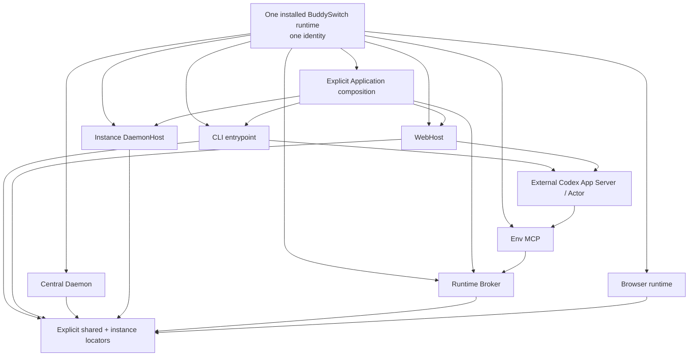

# Target Repository and Runtime Topology Decision

> Audit decision: recommended replacement target
> Status: target-complete, implementation not authorized
> Required next action: propagate into the canonical target design and migration stages

## 1. Decision

Adopt:

```text
src/buddyswitch/**
```

as the **only BuddySwitch Python implementation and packaged runtime source
root**.

This does not mean the repository contains nothing else. The complete decision
is:

1. all executable BuddySwitch Python implementation, runtime contracts,
   packaged assets, Roles and Skills live below `src/buddyswitch/**`;
2. one standard package/build declaration produces one filtered BuddySwitch
   runtime distribution;
3. all BuddySwitch host processes execute that same installed distribution;
4. Actor workspaces do not contain a copy of BuddySwitch implementation code;
5. Actor workspaces receive only selected Role/Skill assets, Actor-private
   space, generated config and the shared `projects/app` projection;
6. root shell entrypoints remain only as stable user interfaces and delegate
   to installed package entrypoints;
7. old `scripts/**`, executable `tools/launcher/**`, runtime
   `buddyswitch/**`, and `framework/**` paths are deleted after their owners
   cut over;
8. no import alias, fallback, symlink, duplicate package, `PYTHONPATH` surgery
   or old/new runtime copy remains.

The exact phrase “final unique source root” means unique **implementation
root**, not that docs, tests, product source and user entrypoints are placed
inside the Python package.

## 2. Final repository tree

```text
BuddySwitch repository/
  pyproject.toml
  buddyswitch-codex                  thin stable public launcher
  buddyswitch-test                   thin stable public test launcher
  AGENTS.md
  README.md
  .gitignore

  src/
    buddyswitch/
      __init__.py
      application/
        composition.py               explicit complete component set
        build.py                     validate and build application hosts
        entrypoints/
          cli.py
          runtime_activation.py
          web.py
          central_daemon.py
          instance_daemon.py
          runtime_broker.py
          env_mcp.py
          app_server.py
          actor_build.py
          browser_runtime.py
          browser_cockpit_proxy.py
          cleanup.py
          diagnostics.py
          browser_evidence.py
          artifact_selection.py

      foundation/
        composition/                 typed passive assembly contracts
        identity/                    shared identity values/invariants
        state/                       explicit locators, atomic files, locks
        actor_runtime/               workspace + instance lifecycle
        process_runtime/             process identity, sockets, logs, cleanup
        app_server/                  Codex App Server client/supervisor
        daemon/                      business-neutral daemon host
        tool_runtime/                protocol, auth, catalog, invoke host
        browser_runtime/             Actor Browser/CDP lifecycle
        web_runtime/                 HTTP/static/route host
        cli_runtime/                 parsing/result host
        role_host/                   narrow reviewed Role discovery/projection

      modules/
        demand/
          module.py
          public/
          private/
          assets/
          skills/
          tests/
            unit/
            contract/
            integration/
        task/
        track/
        artifact/
        communication/
        search/
        evidence/
        context/

      roles/
        market/
          role.py
          AGENTS.md
          private/
          skills/
          assets/
          tests/
        pm/
        design/
        dev/
        test/
        secondary_market_investor/

      assets/
        web/                          generic WebHost assets only

  tests/
    unit/
      architecture/
      foundation/
    integration/                     cross-module/application paths
    process/
    system/
    support/
    runner.py

  projects/
    app/                              external product source seed/mount

  docs/
    arch/
    memo/

  .buddyswitch-runtime/              generated and gitignored
    activation.json                  one active runtime binding
    venv/                            non-editable installed distribution
```

This tree is a responsibility map, not a requirement to create every empty
folder in advance. A folder appears only when its current owner is moved.

## 3. What belongs outside `src/buddyswitch`

| Surface | Final location | Reason |
|---|---|---|
| root `buddyswitch-codex` | repository root | stable user command, no implementation |
| root `buddyswitch-test` | repository root | one stable test command, no policy duplication |
| cross-component/process/system tests | root `tests/**` | shared application and resource ownership |
| `projects/app/**` | repository product mount | source Actors work on, not BuddySwitch framework |
| architecture/current docs | `docs/arch/**` | human current-boundary authority |
| historical/planning docs | `docs/memo/**` | history and execution state |
| repository constitution | root `AGENTS.md` | repository policy |

These are not alternative implementation roots.

## 4. Package and build model

### 4.1 One standard package

`pyproject.toml` becomes the single owner of:

- package discovery from `src`;
- runtime Python requirement;
- module entrypoints;
- packaged data;
- the `setuptools.build_meta` backend;
- test-only dependency declaration or reference;
- explicit distribution exclusions.

The target does not use:

- top-level Python execution by file path;
- `sys.path.insert`;
- repository `PYTHONPATH`;
- parent-depth root inference;
- duplicate setup metadata.

### 4.2 Distribution contents

The BuddySwitch runtime distribution includes:

- application composition and package entrypoints;
- foundation hosts/primitives;
- module runtime code;
- current Role descriptors and packaged assets;
- Role-private and module-exported Skill packages needed for projection;
- required JSON/TOML/Markdown/static assets.

It excludes:

- all co-located `tests/**`;
- root tests and test support;
- docs and memos;
- `projects/app`;
- repository launch wrappers;
- build caches and source-control metadata;
- unselected Actor workspace projections.

The package build has a direct content test. Source-directory presence is not
the distribution contract.

### 4.3 Installation and runtime identity

The checkout-local default runtime is:

```text
<checkout>/.buddyswitch-runtime/venv/bin/python
<checkout>/.buddyswitch-runtime/activation.json
```

An operator may supply another exact root through `BUDDYSWITCH_RUNTIME_DIR`,
but it must have the same `venv/` plus `activation.json` shape. The launcher
derives and exports `BUDDYSWITCH_PYTHON`; an independent interpreter override
is not allowed. There is no `PATH`-Python fallback, editable install, implicit
build during Actor start, or source-tree execution.

Installation is an explicit S1-owned operation:

```text
create isolated environment
  -> build wheel from pyproject.toml
    -> install wheel non-editably
      -> verify content and package root
        -> atomically write activation.json
```

The activation record binds the normalized source root/source digest to the
installed distribution digest and exact interpreter/package root. A source or
distribution mismatch fails before lifecycle mutation.

One installed runtime records at least:

```text
package version
source commit or source-tree identity
distribution digest
Python executable
package root
build timestamp
```

Every BuddySwitch child process reports the same runtime identity in status
and logs. `instance.json` records the identity used to create/start the Actor
for attribution; it does not point to copied source.

The migration does not add a general multi-version runtime manager. One active
record and one active environment are enough. Replacing them is an explicit
operation performed with affected processes stopped; a failed install does not
replace the active record.

## 5. Public launcher model

Final root launchers:

```text
./buddyswitch-codex
  -> resolve runtime directory + deterministic venv/bin/python
  -> installed package parses activation.json
  -> verify source/distribution/interpreter binding
  -> exec python -m buddyswitch.application.entrypoints.cli

./buddyswitch-test
  -> resolve the same installed Python
  -> execute root tests/runner.py as the root-owned test interface
  -> verify activation, clear source PYTHONPATH and prove installed imports
```

The wrappers may validate environment availability and emit structured
failure. They may not:

- source an implementation-heavy shell library;
- set repository `PYTHONPATH`;
- call `src/.../*.py` by path;
- reproduce command or lifecycle semantics;
- fall back to old roots.

The `.py`-path prohibition applies to the product launcher and every
BuddySwitch child process. The root test runner is the D-020 test-only
exception; it is not shipped as product runtime source.

The shell wrappers do not parse activation JSON. `venv/bin/python` is the only
pre-package bootstrap fact; the installed verifier owns the activation schema
and rejects any recorded interpreter mismatch.

Developer setup/build documentation must make the runtime installation step
explicit. A missing installation fails with one actionable error; it does not
silently execute checkout files.

## 6. Final runtime process topology



No BuddySwitch process dynamically loads a file from the source checkout or
Actor workspace.

## 7. Final Actor workspace

```text
${BUDDYSWITCH_SHARED_ROOT}/instances/<actor-id>/
  instance.json
  workspace/
    AGENTS.md                         selected Role projection
    .agents/
      skills/
        <selected-skill>/...         selected Role and exported module Skills
    private/                         Actor-private files
    projects/
      app -> shared project workspace
  home/
  codex-home/
    config.toml                      generated MCP/App configuration
  xdg-config/
  tmp/
  runtime/
    daemon.*
    runtime-broker.*
    app-server.*
  browser/
```

Explicitly absent:

```text
workspace/src/buddyswitch
workspace/scripts
workspace/tools
workspace/framework
workspace/tests
workspace/docs
workspace/all roles
workspace/unselected skills
```

### 7.1 Actor build pipeline

```text
validated installed runtime
  -> application RoleHost discovers and validates one Role
  -> RoleHost resolves selected SkillExport values
  -> Actor builder preflights product mount and source Codex auth
  -> builder stages generated config + selected assets + private dirs + links
  -> builder validates exact allowlist and runtime identity reference
  -> atomic publish
  -> lifecycle starts package entrypoints from installed runtime
```

The builder consumes logical runtime/Role contracts, not repository paths.

### 7.2 `projects/app`

Preserve current semantics:

- repository `projects/app` is a source seed;
- shared project workspace is created once;
- existing shared workspace is not overwritten on every Actor start;
- each Actor receives a link/projection to the shared project;
- deleting an Actor does not delete the shared project.

This capability changes only if a separate product requirement changes it.

## 8. Configuration topology

### 8.1 Package-owned defaults

Defaults and schemas that change with code live with their owner:

- product config and templates inside the owning module;
- generic Web assets inside WebHost;
- Role descriptor/profile/AGENTS/assets inside the Role package;
- Tool/Daemon/route contracts inside their receiving hosts.

### 8.2 Runtime configuration

Generated or operator-specific values live under the explicit shared or
instance root:

- `instance.json`;
- Codex/MCP config;
- Browser endpoint/profile;
- runtime sockets/PIDs/logs;
- user/operator overrides that are current supported interfaces.

### 8.3 Removed central truth

`buddyswitch/manifest.toml` is not copied or preserved as a second Role/Skill
catalog after RoleHost cutover.

The application receives:

- component assemblies from explicit imports;
- module Skill exports from those assemblies;
- Role packages discovered only by RoleHost;
- Role selection of Skill IDs validated against that assembled catalog.

## 9. State topology

The architecture requires explicit locators, not necessarily a data migration.

One `RuntimePaths` or equivalently small immutable locator contract provides:

```text
shared_root
shared_state_root
shared_project_root
instances_root
instance_root
instance_workspace
actor_private_root
instance_runtime_root
instance_tmp_root
```

Product repositories derive their current canonical subpaths from the
injected shared-state locator. They do not inspect package/source paths.

Existing canonical object paths may remain if they are still the intended
current data contract. If a path changes, that is a protected data migration
with one write path, an exact bounded migration phase, removal trigger and
data tests. A source refactor does not silently move user data.

## 10. Component assembly

The composition root explicitly imports one assembly from every current
business/capability component:

```python
COMPONENTS = (
    DEMAND,
    TASK,
    TRACK,
    ARTIFACT,
    COMMUNICATION,
    SEARCH,
    EVIDENCE,
    CONTEXT,
)
```

Names are illustrative until each current owner trace is finalized, but the
activation mechanism is final:

- no component directory scan;
- no string product switch;
- no arbitrary lifecycle callbacks;
- no dependency injection container;
- no second central list of private handlers.

Each assembly is passive and typed. Application construction:

1. validates duplicate component IDs;
2. combines typed host contributions;
3. validates duplicate Tool/command/route/handler/Skill IDs;
4. constructs hosts;
5. returns exact public application services/entrypoints.

Application construction has no process or state side effects.

## 11. RoleHost exception

RoleHost may discover reviewed packaged directories below
`buddyswitch.roles`. This is the only directory-driven extension point in the
target.

RoleHost:

- loads one exact Role descriptor contract;
- validates Role IDs and duplicates fail-closed;
- validates paths/assets stay within the package;
- validates selected Skill IDs against application Skill exports;
- materializes only the selected Role and Skills;
- exposes Role list/lookup to Actor lifecycle;
- does not load product modules or arbitrary plugins.

Adding a Role package is frequent and local. Adding/removing a product
component remains an explicit application-composition change.

## 12. Test topology

The one public test entry learns two approved source sets:

```text
root tests/{unit,integration,process,system}
src/buddyswitch/modules/*/tests/{unit,contract,integration}
src/buddyswitch/roles/*/tests/{unit,contract,integration}
```

Rules:

- focused paths must belong to exactly one approved owner/tier;
- component `system` or `process` tiers are forbidden;
- full mode discovers each approved test exactly once;
- root system tests retain the global resource lock;
- architecture tests enforce dependency/privacy/composition/package-content
  rules;
- the built runtime distribution contains no tests.

## 13. Old-root disposition

| Current path | Final disposition |
|---|---|
| executable/product `scripts/**` | move to owner under package, then delete |
| executable `tools/launcher/**` | move to owner under package, then delete |
| `tools/launcher/assets/roles/**` | move to Role packages, then delete |
| `tools/launcher/assets/web-management/**` | move to WebHost package assets, then delete |
| runtime `buddyswitch/manifest.toml` | RoleHost/component export replacement, then delete |
| `buddyswitch/env-profiles/**` | move into Role packages/owned config, then delete |
| `buddyswitch/skills/**` | move to Role or module owner, then delete |
| runtime `framework/contracts/**` | move to Role/module/foundation owner, then delete |
| `framework/config/**` | move to product owner, then delete |
| root tests | remain for shared proof; module-private tests may move |
| root docs | remain under current/historical authority |
| `projects/app/**` | remain as product source mount |
| root shell commands | remain thin and path-independent |

Old directories may exist transiently only for owners not yet migrated. A
migrated owner has no live old file, import, registration, test assertion,
Skill reference, help text or fallback.

## 14. Why this is the smallest sufficient target

This target adds only mechanisms required by current evidence:

- a standard package because `src/` otherwise cannot run cleanly;
- one installed distribution because Actor and checkout provenance currently
  diverge;
- explicit component assembly because product details are scattered across
  hosts;
- narrow RoleHost because Role addition is a real frequent extension;
- filtered projections because Actors need selected content, not the source
  tree;
- explicit locators because package depth must not define state.

It does not add a plugin platform, service mesh, event bus, DI container or
version-negotiation system.

## 15. Decision effects

The following prior migration assumptions are replaced:

| Prior assumption | Correct target |
|---|---|
| copy new source package into Actor workspace | Actor workspace contains no BuddySwitch implementation |
| Demand can be the first isolated code move | packaging/runtime/lifecycle foundation must first make one runnable package path |
| Browser is a product-module lane | Browser is an Actor host capability unless new product evidence appears |
| RoleHost can read product-private Skills | modules export typed Skill artifacts; Roles select IDs |
| foundation can converge after product moves | minimum package, locators, host contracts and application construction precede product cutover |
| test relocation is part of Demand movement | runner/package-content support is a prerequisite stage |

This target resolves the design questions behind F-001 through F-010,
F-015 through F-018 and F-020. Those findings close only after the canonical
target and revised stage pack adopt this decision.
