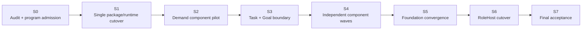

# Migration Stage Readiness Review

> Audit decision: replace the existing S0–S6 sequencing
> Current authorization: S0 only, documents and audit
> Runtime implementation: not authorized

## 1. Conclusion

The existing roadmap is **not implementation-ready**.

Its principal ordering defect is:

```text
old: Demand module pilot
  -> more product modules
  -> foundation convergence
```

Demand currently executes through copied Actor runtime code and checkout-loaded
handlers. Moving Demand first would require one of:

- copying part of the new `src` package into Actor workspaces;
- importing the new package from the checkout while old runtime code remains
  copied;
- adding temporary aliases/adapters from old paths;
- letting some lifecycle operations use new code and others old code.

All are contrary to the accepted target.

The replacement sequence is:

```text
audit and target freeze
  -> one packaged runtime and code-free Actor workspace
  -> Demand proves component assembly
  -> Task proves a cross-component Public boundary
  -> remaining components migrate owner by owner
  -> shared hosts converge
  -> RoleHost replaces central Role/Skill truth
  -> final system/replacement acceptance
```

## 2. Replacement dependency graph



This graph is intentionally more serial than the desired final architecture.
Migration sequencing follows shared current seams; final architecture removes
those seams so later product work becomes parallel. Pretending the current
repository already has the final parallelism would create overlapping writes
and hidden dual paths.

## 3. Stage S0 — Audit and program admission

### Outcome

> An executor can identify the complete current topology, exact target
> topology, stage order, owner/residue scope, proofs and stop conditions
> without inferring architecture during implementation.

### Deliverables

- completed A01–A12 evidence map;
- complete finding register;
- accepted target repository/runtime tree;
- accepted package and Actor projection model;
- accepted product/foundation/Role classification;
- revised roadmap and all stage charters;
- complete initial residue register;
- exact S1 implementation-plan brief;
- no runtime changes.

### Gate

S0 is accepted only when every CRITICAL/HIGH finding either:

- is closed by an accepted target/stage/proof decision; or
- is assigned as an exact runtime implementation obligation in S1+ and does
  not require executor architecture judgment.

Final audit state: `ACCEPTANCE_PENDING`, runtime work unauthorized.

## 4. Stage S1 — Single package and runtime cutover

### Why this stage exists

The package/runtime provenance boundary crosses every Actor lifecycle
operation. It cannot be safely merged owner by owner.

S1 is a large but coherent vertical replacement:

> Every BuddySwitch process and lifecycle operation executes one installed
> package built from `src/buddyswitch/**`; Actor workspaces contain no
> BuddySwitch implementation; old executable source roots are absent.

### Scope

1. add one `pyproject.toml` and package content rules;
2. establish package entrypoints;
3. move all current executable Python and runtime assets under the package;
4. use explicit runtime/shared/instance locators;
5. move Actor environment and lifecycle ownership into the package;
6. replace runtime code copying with selected Role/config/private/project
   projection;
7. make CLI, Web, Daemon, Broker, MCP, Browser and App supervisors execute the
   same installed runtime;
8. record/report one runtime identity;
9. preserve current product behavior and fine-grained composition;
10. update all tests/guidance for new package paths;
11. delete executable `scripts/**`, executable `tools/launcher/**`, old runtime
    assets and path bootstraps.

### Deliberate intermediate truth

Product behavior may still be arranged by technical package inside
`src/buddyswitch/**` immediately after S1. Its semantics are current, not
“legacy,” and no old root remains.

S1 does not add compatibility aliases. It changes import and deployment
location directly while preserving behavior.

### Internal checkpoints

S1 may use reviewable commits/checkpoints on one stage branch:

1. package/content RED and fixture support;
2. package entrypoint and locator skeleton driven by current lifecycle;
3. source/assets movement with imports updated;
4. unified process launches and runtime identity;
5. Actor projection cutover;
6. lifecycle/error/cleanup acceptance;
7. old-root deletion and guidance replacement.

No checkpoint is merged to the main branch independently. The repository's
accepted runtime remains the pre-S1 truth until the full S1 candidate passes.

### Direct acceptance

- build/install succeeds from a clean checkout;
- distribution content contains all required runtime assets and no tests/docs;
- `./buddyswitch-codex` works without source `PYTHONPATH` or file execution;
- start, status, input, interrupt, compact, clear, stop, resume and delete pass;
- Web start/retry/IM and Browser lifecycles pass at affected breadth;
- one Tool request reports the same runtime identity across MCP/Broker/handler;
- Actor workspace allowlist proves no BuddySwitch implementation or unselected
  Role/Skill content;
- old roots/imports/help/guidance are absent;
- process/socket/lock/temp cleanup is clean.

### Stop conditions

- any need for a fallback to checkout code;
- any Actor lifecycle operation still needs copied implementation;
- package data cannot represent a current runtime asset;
- one process reports a different source/runtime identity;
- moving code reveals unresolved semantic duplication.

## 5. Stage S2 — Demand component pilot

### Outcome

> Demand has one physically aggregated module root and one explicit assembly;
> private Demand work changes only that root; the application selects Demand
> once and generic hosts know no Demand semantics.

### Scope

- introduce only the typed host contribution contracts Demand currently needs;
- introduce explicit application component assembly;
- move complete Demand domain/state/adapters/assets/exported Skills/tests;
- shrink direct central imports for Demand to one module assembly;
- update Context/Web/Task consumers to Demand Public operations;
- add runner support for co-located module tests;
- update package exclusion/content proof;
- delete all former in-package Demand paths and current guidance references.

### Intermediate assembly rule

Unmigrated components may remain explicitly fine-grained in the application
root. Demand is never simultaneously on the old and module assembly paths.

This is one visible staged current truth, not a generic adapter or second
registry.

### Direct acceptance

- Demand behavioral baseline remains exact;
- duplicate/invalid Demand contributions fail application build;
- Daemon/Tool/Web/Skill surfaces arrive only through `DEMAND`;
- Demand private dependency and residue architecture tests pass;
- Actor runtime distribution contains Demand runtime/selected Skill assets but
  no Demand tests;
- full Actor lifecycle remains clean.

## 6. Stage S3 — Task and native Goal boundary

### Outcome

> Task owns canonical Task state and native Goal convergence in one module;
> Demand and Task collaborate through exact acyclic Public operations, never
> private state or generic ToolContext reach-through.

### Scope

- move Task domain/state/Tool/Daemon/Web/test ownership;
- define only the Demand Public edge with a real Task consumer;
- preserve Codex App Server ownership of native Goal state;
- remove Task/Demand private cross-imports;
- update Context projection through public reads;
- delete former Task/Goal paths and guidance.

### Direct acceptance

- create/cancel/checkpoint/recovery/Goal reconciliation outcomes remain exact;
- Demand completion validates terminal Task evidence through owner contracts;
- no module imports another module's `private`;
- public dependency graph remains acyclic;
- clear/resume/Daemon recovery pass.

## 7. Stage S4 — Independent component waves

### Outcome

> Every remaining business/capability owner becomes a physically aggregated
> component with one runtime path and its own typed host contributions.

### Lanes

After S3 proves the model, create one implementation plan and acceptance
candidate per lane:

1. Track and comments;
2. Artifact and relations/visibility/selection config;
3. Communication/IM, external session and iMessage channel;
4. Search capability;
5. Evidence capability;
6. Context application projection.

Browser is not an S4 product lane. Its Actor-resource lifecycle belongs to
foundation convergence.

### Parallelism rule

Lanes may run in parallel only after:

- application and host contribution contracts are frozen;
- each lane's files, tests, state and guidance ownership is disjoint;
- application-root changes have one integration owner;
- Context waits for the public projections it consumes;
- Communication owns its Web worker lifecycle without editing generic WebHost.

Each lane merges separately and deletes its old in-package paths in the same
candidate.

### Context ordering

Context is last within S4 because it consumes the assembled public read
surfaces. It replaces broad hard-coded ToolContext product access rather than
preserving it.

## 8. Stage S5 — Foundation convergence

### Outcome

> Foundation contains only business-neutral hosts/primitives; all product
> meaning arrives through typed component contributions.

### Scope

- remove remaining fine-grained product imports from application entrypoints;
- finish ToolHost explicit registration and delete directory scanning;
- reduce ToolContext to host facts and injected public capabilities;
- finish WebHost/CliHost route/command contribution boundaries;
- establish Browser as one Actor-runtime capability owner;
- split lifecycle cleanup from module cleanup contributions;
- remove dynamic file loading and any `repo_root` runtime source dependency;
- consolidate process identity, locators, locks, sockets, logs and status;
- enforce foundation-to-product import prohibition.

S5 is convergence, not a place to defer owner work from S2–S4. Every migrated
component must already own its semantics before S5.

## 9. Stage S6 — RoleHost cutover

### Outcome

> A reviewed Role package is added locally by package directory; invalid Roles
> fail before Actor publication; the central Role/Skill catalog and duplicate
> profile/contract paths are absent.

### Why it follows component migration

RoleHost validates selections against module-exported `SkillExport` values.
Those exports must have final owners before the central catalog is removed.

### Scope

- implement narrow Role package discovery only under packaged `roles`;
- move descriptors, profiles, `AGENTS`, Role-private Skills/code/assets/tests
  into Role packages;
- combine module Skill exports with Role-private exports;
- materialize only selected content;
- update Role list/start/config/help/Web consumers;
- delete the central manifest/catalog and former Role/profile/Skill/contract
  assets;
- prove a new secondary-market-investor Role requires no central host edit.

This stage does not implement the Role's future product behavior unless
separately scoped. It proves the extension boundary.

## 10. Stage S7 — Final acceptance

### Outcome

> Product, Contract, Architecture, Replacement and Operations evidence agree
> that the explicit modular monolith and narrow RoleHost are the only live
> BuddySwitch architecture.

### Scope

- run frozen full candidate proof;
- execute representative real Actor journeys across multiple Roles;
- verify package/runtime identity and distribution content;
- scan old paths, aliases, scanners, dynamic loads, duplicate catalogs and
  obsolete guidance;
- verify state compatibility/migrations and cleanup;
- promote final current boundaries into `docs/arch/**`;
- close findings/residue or reject readiness;
- archive migration execution docs as historical state.

S7 does not repair broad defects. A material defect reopens the owning stage.

## 11. Stage ownership table

| Cross-cutting surface | First changing stage | Final owner/stage |
|---|---|---|
| package/build/runtime identity | S1 | foundation/package |
| root launchers | S1 | thin public interfaces |
| Actor builder/workspace projection | S1 | Actor runtime |
| all Actor lifecycle transitions | S1 and regression every stage | Actor runtime |
| explicit component assembly | S2 | application composition |
| module test discovery | S2 | one test runner |
| Demand | S2 | Demand |
| Task/Goal edge | S3 | Task + exact Demand Public |
| Track/Artifact/Communication | S4 lanes | respective components |
| Search/Evidence/Context | S4 lanes | capability/projection components |
| Tool scanner/ToolContext | affected incrementally; removed S5 | ToolHost/application |
| Web/CLI product imports | affected per component; removed S5 | hosts + contributions |
| Browser lifecycle | S1 path cutover; S5 final boundary | Actor Browser runtime |
| cleanup | S1 path cutover; per module contributions; S5 host convergence | lifecycle host + modules |
| Role central catalog | moved as current truth S1; removed S6 | RoleHost + exports |
| current `docs/arch` | each stage for changed truth | owning architecture doc |

## 12. Readiness state after this review

| Stage | State | Reason |
|---|---|---|
| S0 | ACCEPTANCE_PENDING | R0–R3 complete; explicit maintainer admission remains |
| S1 | PROPOSED | audit-reviewed blueprint exists; execution-source refresh and READY review remain |
| S2 | BLOCKED | requires S1 accepted |
| S3 | BLOCKED | requires S2 accepted |
| S4 | BLOCKED | requires S3 accepted |
| S5 | BLOCKED | requires S4 accepted |
| S6 | BLOCKED | requires final module Skill exports |
| S7 | BLOCKED | requires S1–S6 accepted |

No runtime implementation should begin from the old S1 Demand charter.

## 13. Executor handoff requirement

Each stage receives a dedicated implementation plan only after its predecessor
is accepted. The handoff contains:

```text
stage outcome
source identity and dirty-scope inventory
exact current consumer trace
exact write/move/delete scope
protected external/data contracts
direct RED/preservation proof
ordered implementation blocks
per-block runnable checkpoint
residue rows owned
verification commands
stop conditions
final acceptance template
```

The executor is never asked to interpret the entire program and invent a
local path.

## 14. Audit effect

This review invalidates the old roadmap's:

- Demand-first runtime sequence;
- Browser product-module lane;
- late treatment of Actor runtime and package topology;
- partial Role/Skill boundary;
- assumption that foundation convergence can repair shared consumer seams
  after product moves without prior contracts.

The canonical roadmap and stage charters have been rewritten to match S0–S7.
S0 now waits only for the explicit maintainer admission defined by report 06.
