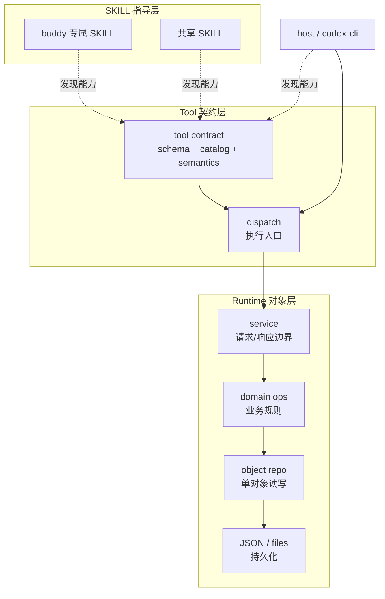

# BuddySwitch 并行开发模块化架构

## 结论

目标只有一个：提高核心模块的并行开发效率。

本方案采用“薄封装”，不是“大抽象”：

```text
SKILL -> Tool Contract -> Service -> Domain Ops -> Object Repo -> JSON / Files
```

它解决三件事：

1. Tool layer 可以独立开发和扩展，尽量不影响 SKILL 或上层调用。
2. Buddy 专属 / 共享 SKILL 可以独立维护，尽量不影响 runtime。
3. `artifact`、`track`、`task`、`message`、`comment`、`buddybox` 可以按边界并行开发，彼此影响可控。

不引入 workflow engine、plugin system、event bus、通用对象框架。

## 整体视图

这张图看整体解耦度：三块可以并行开发，但运行时仍然走一条主链路。



读图方式：

- `SKILL` 负责“什么时候用、怎么判断、业务流程”。
- `Tool Contract` 负责 action、payload schema、catalog、semantics、dispatch 对齐。
- `Service` 负责把 tool 请求转成 domain 调用，再包装 runtime response。
- `Domain Ops` 负责业务规则和必要的跨对象协调。
- `Object Repo` 只负责单对象 schema、路径、读写、校验。

## 分层边界

| Layer | Owns | Does not own |
| --- | --- | --- |
| `SKILL` | 使用判断、业务流程、角色经验 | payload schema、dispatch 注册表、对象存储结构 |
| `Tool Contract` | action 名称、payload、catalog、semantics、权限声明 | 对象内部存储、跨对象业务规则 |
| `Service` | 输入适配、错误反馈、response shape | JSON 直接写入、跨对象状态决策 |
| `Domain Ops` | 业务规则、权限判断、跨对象协调 | 通用 workflow、plugin、event engine |
| `Object Repo` | 单对象 schema、normalize、load/save/list | sibling object mutation |

最重要的约束：

```text
跨对象规则只能在 Domain Ops；
Repo 不能互相调用；
SKILL 不能复制 runtime contract。
```

## SKILL / Tool Contract 衔接规则

`SKILL` 和 `tool` 的稳定衔接面只有 runtime discovery：

```text
context.get.tool_catalog
context.get.operation_semantics
context.summarize.tool_affordances
python3 scripts/turn_runtime.py status
runtime env.tool response fields
```

普通 shared tool skills 默认引用 `context.get.tool_catalog['<tool>']`、`context.summarize.tool_affordances`、`python3 scripts/turn_runtime.py status` 和 runtime response fields。`context.get.operation_semantics` 是 runtime 可暴露的机器语义投影，可用于 runtime verification 和高级诊断；不要在 skill prose 中复制或解释它的表结构。

`SKILL` 可以写：

- 什么时候使用某类 tool；
- 如何判断当前 workflow 需要哪种能力；
- 先查哪些 runtime discovery 面；
- 成功后如何验证 `ok`、`state_changed`、`state_changes`、returned ids；
- 失败后如何读取 `permission_boundary`、`why_blocked`、`retry_guidance`、`allowed_next_actions`、`alternative_capabilities`。

`SKILL` 不能写：

- action / payload / return schema 表；
- per-tool package 内部路径；
- `tool.py` / `_impl.py` 私有实现细节；
- object repo 路径或 JSON 存储结构；
- 与 runtime catalog 不一致的 payload 示例。

每个 tool 的契约来源是：

```text
scripts/env/tool_runtime/definition.py
scripts/env/tool_runtime/registry.py
scripts/env/tools/<tool>/tool.py
scripts/env/tools/<tool>/_impl.py
```

shared runtime 只负责发现、投影、路由、dispatch、response formatting。SKILL 通过 runtime discovery 消费能力，不复制能力。

## 外部实践依据

这个方向符合主流 agent/tool 架构：

- MCP tools 通过 `tools/list` 暴露工具，并用 `inputSchema` / `outputSchema` 描述参数和输出；host 可以发现并调用工具。见 [MCP Tools](https://modelcontextprotocol.io/specification/draft/server/tools)。
- OpenAI Apps SDK 的 MCP server 负责定义 tools、auth、返回数据和 UI 关联，工具契约在 server 侧而不是 prompt 里。见 [OpenAI Apps SDK MCP Server](https://developers.openai.com/apps-sdk/build/mcp-server)。
- Claude Skills / Agent Skills 主要是按需加载的 instructions、workflows、resources，不应成为工具注册表。见 [Claude Skills overview](https://claude.com/docs/skills/overview)。

所以简化 SKILL 不会削弱工具能力。前提是 tool catalog、operation semantics、runtime response 足够完整，host / Codex CLI 可以直接发现并调用相关 tool，不必完全依赖 SKILL。

## 对象解耦

| Object | Owns | Allowed coupling | Must not do |
| --- | --- | --- | --- |
| `message` | direct send、inbox、reply 规则 | manifest buddy ids | mutate track / task / artifact / comment |
| `comment` | comment shape、thread、resolve/reopen | 通过 domain 检查 target readable | mutate target object state |
| `buddybox` | active-buddy private files | source_refs 可引用 logical_name 作为 provenance | become product-readable state |
| `artifact` | draft/revision/body/readability | 发布后被 track refs 读取 | 直接改 track shared refs |
| `track` | shared collaboration page、material/proof refs | publication domain 协调 artifact 状态 | own artifact body/schema |
| `task` | active-buddy work item state | 可引用 track_id 作为工作上下文 | 承担 artifact 发布或 track shared state |

`track` 和 `artifact` 不是完全隔离：发布本身就是跨对象业务。这里要做的是“受控耦合”，只允许一个发布入口。

## Track / Artifact 发布路径

`track-artifact-pm-runtime-repair` 合并后，唯一共享发布路径应是：

```text
artifact.create_revision -> track.add_material / track.add_proof -> track.open -> artifact.get
```

含义：

- `artifact.create_revision` 创建 active-buddy 草稿 / revision。
- `track.add_material` 和 `track.add_proof` 是共享发布入口。
- 发布时由 domain ops 同步 artifact 状态和 track 引用。
- `track.open` 读共享引用，`artifact.get` 读完整正文。
- `published_to_track` 不再作为 artifact 侧的直接发布输入。

## 并行开发方式

| Work | Should touch | Should not touch |
| --- | --- | --- |
| 新增 tool action | `tool.py` definition、对应 `_impl.py`、对应 domain/repo | 无关 SKILL、无关 tool |
| 修改 buddy SKILL | 对应 SKILL 文件 | Python runtime |
| 修改 shared SKILL | shared SKILL 文件 | dispatch、object repo |
| 修改 message | message `_impl.py`/domain/repo/test | track、artifact、comment |
| 修改 comment | comment `_impl.py`/domain/repo/test | target object mutation |
| 修改 buddybox | buddybox `_impl.py`/file repo/test | product object repos |
| 修改 track/artifact 发布 | publication domain、track/artifact repo、相关 `_impl.py` | message、comment、buddybox、task |

## 已落地基础

`black-box runtime` 完成后，tool-specific ownership 已收敛到：

```text
scripts/env/tool_runtime/
  definition.py
  context.py
  results.py
  registry.py
scripts/env/tools/<tool>/
  tool.py
  _impl.py
```

host runtime 只依赖 `env.tool_runtime.registry` 和 `env.tools.<tool>.tool`，不依赖 per-tool 私有实现文件结构。

接下来维护的边界是：

1. 新增或修改 tool action，只改对应 tool package 和该 tool 的 focused tests。
2. 修改 shared / buddy-specific `SKILL`，不改 Python runtime。
3. `SKILL` 通过 runtime discovery 获取精确 action、payload、semantics、response guidance；普通 shared tool skills 不复制或讲解 `operation_semantics` 表结构。
4. cross-object product coupling 仍然只允许在 explicit domain modules 中出现。

## 完成标准

架构边界成立必须同时满足：

1. 新增或修改一个 tool action，不需要改 shared SKILL。
2. 修改一个 buddy-specific 或 shared SKILL，不需要改 Python runtime。
3. shared tool skills 都指向 `context.get.tool_catalog['<tool>']` 或 `python3 scripts/turn_runtime.py status` 获取精确 payload / action / response guidance。
4. prose 文档和 SKILL 不复制 `payload_fields`、`action_semantics`、`operation_semantics`、action/payload 表。
5. `context.get` 返回的 `tool_catalog` 和 `operation_semantics` 等于 `env.tool_runtime.registry` 的投影；`operation_semantics` 只作为 runtime discovery/result surface，不作为 skill prose mirror。
6. catalog projection 不 import tool 私有实现、domain、repo。
7. selected dispatch 不 import sibling tool `_impl.py`。
8. object repo 没有 sibling repo import。
9. `track/artifact/comment` 的真实产品耦合保留在 explicit domain modules。
10. `python3 -m pytest tests/test_runtime_skills.py tests/test_repo_consistency.py tests/test_env_tool_response_contract.py -q` 通过。
